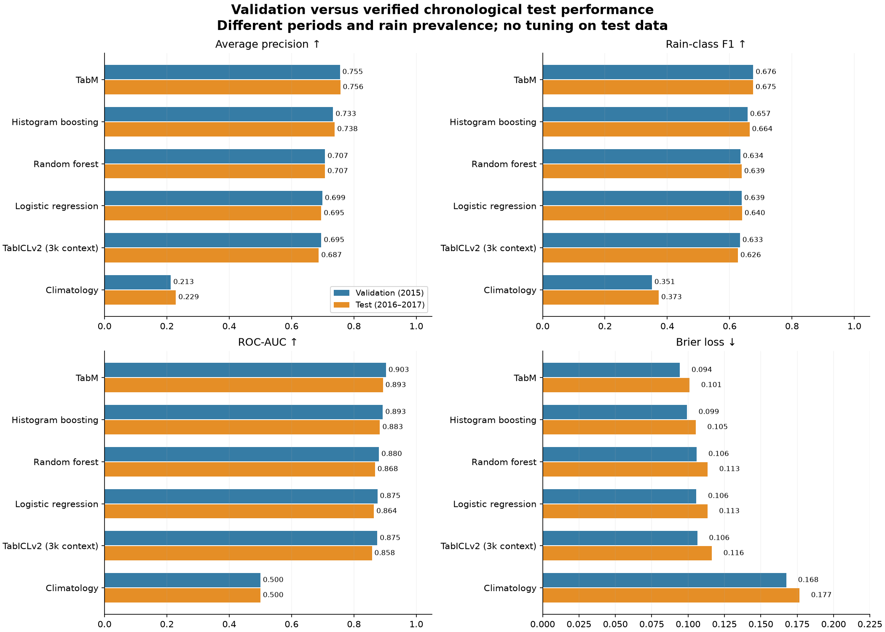
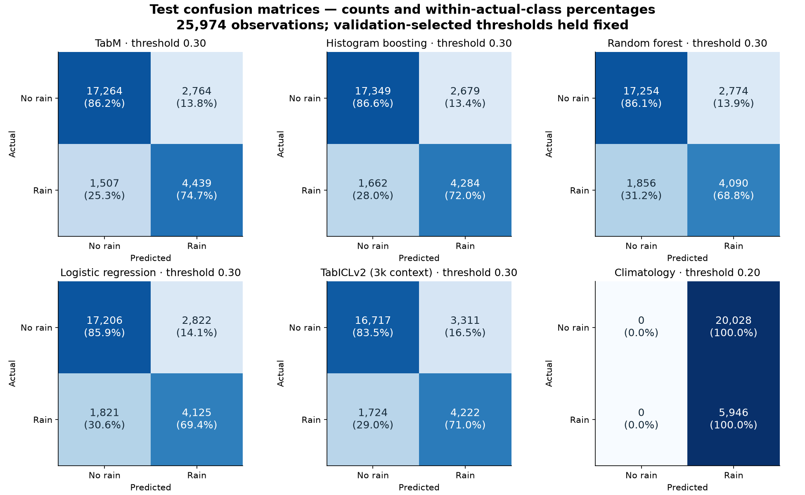
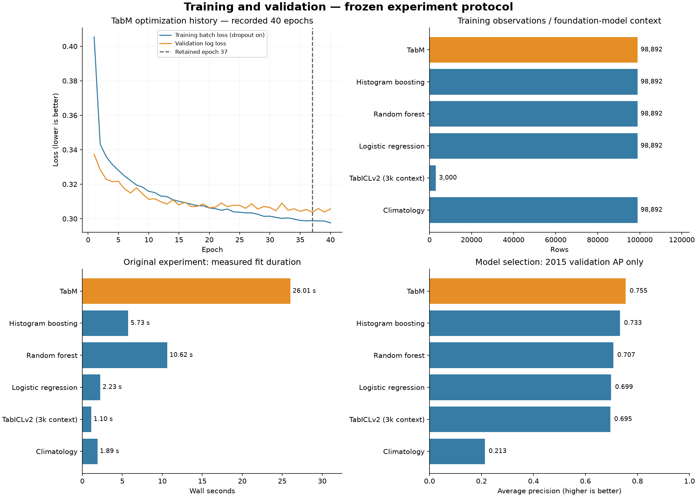
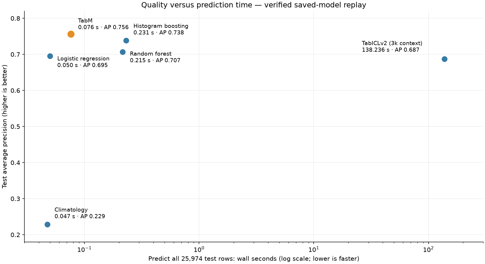

# RainScope ML — Australian Rainfall Prediction

Compare classical machine learning, **TabM** and **TabICLv2** for next-day rain classification from historical Australian weather observations.

**By Bola Maged Ramses Nessim** · [Docker Hub image](https://hub.docker.com/r/bmaged23/rainscope-ml) · [Setup & dashboard](docs/GETTING_STARTED.md) · [Detailed results](reports/RESULTS.md) · [Source attribution](docs/ATTRIBUTION.md)

## Model results

**TabM led this comparison:** accuracy **83.56%**, ROC-AUC **0.893**, average precision **0.756**, and rain-class F1 **0.675**.

| Model | Accuracy | Precision | Recall | F1 | ROC-AUC | Average precision |
| --- | ---: | ---: | ---: | ---: | ---: | ---: |
| **TabM** | 83.56% | 0.616 | 0.747 | 0.675 | 0.893 | 0.756 |
| Histogram gradient boosting | 83.29% | 0.615 | 0.720 | 0.664 | 0.883 | 0.738 |
| Random forest | 82.17% | 0.596 | 0.688 | 0.639 | 0.868 | 0.707 |
| Logistic regression | 82.12% | 0.594 | 0.694 | 0.640 | 0.864 | 0.695 |
| TabICLv2 (3k context) | 80.62% | 0.560 | 0.710 | 0.626 | 0.858 | 0.687 |
| Climatology baseline | 22.89% | 0.229 | 1.000 | 0.373 | 0.500 | 0.229 |

All results use **25,974 test observations from 2016–2017**. Model and threshold were selected on 2015 validation data before the test pass. TabICLv2 uses a 3,000-row training context; other models use 98,892 training rows. Precision, recall and F1 refer to **rain**. The climatology baseline's validation-selected threshold predicts every row as rain; its accuracy is not majority-class accuracy.


Higher is better for AP, ROC-AUC, F1, precision and recall; **lower is better for Brier loss**. Orange highlights TabM.

## Model verification

A fresh replay on **22 October 2026** reproduced all six saved models’ holdout metrics within absolute tolerance **1e-5**, without retraining or changing thresholds. A separate artifact audit matched imputation statistics, scaler sample counts and category vocabularies to the frozen training recipe. TabICLv2 uses its original 3,000-row training context.


These are descriptive 95% month-cluster bootstrap intervals, not evidence of statistically significant superiority. This is the same historical holdout, not an independent new benchmark. An always-no-rain baseline would reach **77.11% accuracy with zero rain recall**, which is why rain-class F1, AP and calibration matter alongside accuracy.

[Verification results, resources and reproducibility commands](reports/model_verification/README.md)

## Validation versus test

Compare all six models on AP, rain-class F1, ROC-AUC and Brier loss. The periods have different rain prevalence, so a difference between validation and test is descriptive; thresholds remain frozen from validation.



## Correlation heatmap

Pearson correlations for numeric weather features and the rain target, calculated on **training observations only** using pairwise non-missing values. Correlation does not establish causation.


## Precision–recall, ROC and probability reliability


The precision–recall curve shows rain detection versus false alarms; ROC shows ranking across thresholds. The reliability diagram compares predicted probabilities with observed rain frequencies.

## Test errors across all models

At the validation-selected threshold of **0.30**, TabM correctly identifies **4,439 rainy records** and **17,264 non-rainy records**; it misses **1,507 rainy records** and produces **2,764 false alarms**.



Rows represent actual classes; percentages are normalized within each row. The rain-row diagonal is rain recall. The climatology threshold predicts rain for every observation, making its false-alarm behavior explicit.

## Training process

Recorded TabM training and validation losses across **40 epochs**, alongside training-row budgets, fit times and validation model selection for all six models. The dashed line marks **retained epoch 37**, using the original minimum-improvement rule; test data was not used for early stopping. Training loss is a batch mean measured with training-time dropout enabled.

Only TabM has recorded epoch-level history. The other models are represented by their measured fit durations and validation results; TabICLv2’s 3,000-row context is not equivalent to training a neural model from scratch.



## Performance across months and stations

Monthly AP/F1 uses the **same fixed 0.30 threshold** throughout the final test period. The station panel displays the five lowest and highest AP slices, with sample counts. Station scores also depend on local rain prevalence; these are descriptive diagnostics, not an unseen-station evaluation.


## Feature importance

Validation-only permutation importance measures the decrease in average precision when a feature is shuffled. **Humidity at 3pm, wind-gust speed, station location and pressure change** had the largest drops. Correlated features can share predictive information.


## Data quality and processing

**145,460 raw records · 49 stations · 3,267 missing targets excluded.** Sunshine is **48.0% missing** and evaporation **43.2% missing**. Numeric inputs use training-fitted median imputation with missingness indicators; categorical encoders are fitted only on training data.


A separate logistic-regression check on validation data found:

| Processing variant | Validation average precision |
| --- | ---: |
| Configured features and missingness indicators | 0.69885 |
| Without missingness indicators | 0.69525 |
| Without derived seasonal/pressure/humidity features | 0.69575 |
| Without numeric columns above 40% training missingness | 0.69683 |

These are modest, single-seed sensitivity results for logistic regression; they do not prove that every model benefits equally. [Recorded values](reports/preprocessing_sensitivity.csv)

## Measured runtime

Reference GPU: **NVIDIA GTX 1660 Ti, 6 GB**. These are measured in-process wall times, not deployment latency guarantees.

| Model | Fit time | Predict 25,974 rows |
| --- | ---: | ---: |
| **TabM** | 26.01 s | 0.099 s |
| Histogram gradient boosting | 5.73 s | 0.250 s |
| Random forest | 10.62 s | 0.221 s |
| Logistic regression | 2.23 s | 0.064 s |
| TabICLv2 (3k context) | 1.10 s | 139.442 s |
| Climatology baseline | 1.89 s | 0.194 s |

TabICLv2 performs in-context computation during prediction, so its short fit time does not mean cheap inference. [RAM, CPU and PyTorch-memory measurements](reports/resources.json) include interpreter/resident-model overhead; they are not isolated per-model memory requirements.



The scatter uses the fresh saved-model verification run, while the table above records the original experiment. Its horizontal axis is logarithmic and measures prediction of the **entire 25,974-row test set**, not one HTTP request. Hardware, preprocessing and context computation affect these timings.

## Prediction API and deployment

The project now includes a **FastAPI prediction service**, interactive API docs, GPU/CPU Docker configurations, readiness checks and Prometheus-text counters. The main GPU service uses the trained TabM winner; a separately trained CPU baseline supports machines without CUDA. The complete CPU image bundles its fitted model; the GPU source-build route uses a local trained artifact.

A local GPU run of 200 sequential HTTP requests (two synthetic records each) measured **20.5 ms median / 23.4 ms p95** and approximately **803 MiB sampled server RAM**. These are local serving measurements, not production guarantees.

[Run the API and Docker demo](docs/SERVING.md) · [Measured HTTP latency and resources](reports/SERVING_RESULTS.md) · [Example request](deployment/example_request.json)

## Docker Hub — run without Python setup

**Public repository: [bmaged23/rainscope-ml](https://hub.docker.com/r/bmaged23/rainscope-ml)** · Published tag: [`cpu`](https://hub.docker.com/r/bmaged23/rainscope-ml/tags?name=cpu)

**Pull-and-run verified:** anonymous Docker Hub pull, new container with no model/data mounts, readiness and predictions passed on Linux amd64. [Verification record](reports/dockerhub_pull_test.json).

The **CPU API image** includes the trained histogram-gradient-boosting model and its preprocessing. It does not require a model mount, dataset download or training at startup. Supported release target: **Linux amd64**, including compatible Windows Docker Desktop/WSL2 installations.

```bash
docker pull bmaged23/rainscope-ml:cpu
docker run -d --name rainscope -p 127.0.0.1:8000:8000 bmaged23/rainscope-ml:cpu
```

Open **http://localhost:8000/docs** to submit observations. This runs the API, not the Streamlit dashboard, and it does not fetch live weather. [Docker Hub](https://hub.docker.com/r/bmaged23/rainscope-ml) · [Example request, checks and cleanup](docs/SERVING.md) · [Release verification status](reports/SERVING_RESULTS.md)

## Tests, CI and image releases

Run local checks with `python -m pip install -r requirements-dev.txt` and `python -m pytest`. GitHub Actions is configured to run lint/tests and build the CPU image, then check real predictions without model mounts on each push or pull request.

A separate release workflow builds and tests an image before publishing it to Docker Hub, then pulls and tests the published commit tag. It requires the maintainer’s `DOCKERHUB_TOKEN` Actions secret, which is now configured. **Remote checks passed:** [CI tests and container prediction](https://github.com/bmaged23/rainscope-ml/actions/runs/39844918468) and [Docker Hub build/publish/pull verification](https://github.com/bmaged23/rainscope-ml/actions/runs/39844973128). The released CPU image includes its model; GPU container verification is still pending.

[CI/CD workflow and maintainer setup](docs/CI_CD.md) · [GitHub Actions](https://github.com/bmaged23/rainscope-ml/actions)

## Quick start — CPU

Requires Python 3.13 and Git. From a Linux/WSL terminal:

```bash
git clone https://github.com/bmaged23/rainscope-ml.git
cd rainscope-ml
python3.13 -m venv .venv
source .venv/bin/activate
python -m pip install --upgrade pip
python -m pip install -r requirements.txt
python -m pip install -e . --no-deps
python scripts/download_data.py
python -m rainscope.train --root . --config configs/cpu.json
python -m streamlit run app.py
```

Open **http://localhost:8501** after training finishes. This trains four CPU baselines and creates the prediction artifact locally. To reproduce the six-model GPU study, use `requirements-modern.txt` and `config.json` as explained in the [complete setup guide](docs/GETTING_STARTED.md), which also includes Windows commands, the API, tests and troubleshooting.

## Reproduce and explore

[Installation, training and dashboard](docs/GETTING_STARTED.md) · [Configuration](config.json) · [Experiment protocol](docs/EXPERIMENT_PROTOCOL.md) · [Model card](docs/MODEL_CARD.md)

This is a single-seed historical study with shared stations across time, not an operational weather service or an unseen-station benchmark. The rebuilt implementation preserves the [original repository's attribution](docs/ATTRIBUTION.md) and [GPL-3.0 licence](LICENSE); raw observations are not republished. The CPU container includes the project-trained serving model; Git excludes model binaries.
