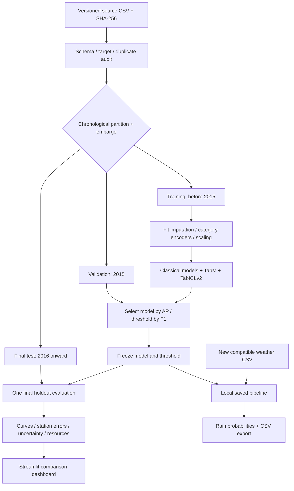

# RainScope ML — Australian Rainfall Prediction & Model Evaluation

A reproducible tabular machine-learning study and interactive dashboard by **Bola Maged Ramses Nessim**. Compare classical models and recent tabular architectures on a chronological Australian weather holdout, then inspect errors, probability quality and compute requirements.

**Question:** given a historical daily weather record, will the next recorded day meet the dataset's rain threshold? This is a research portfolio project, not an operational weather service.

The project rebuilds the evaluation and application around an earlier Australian-rain repository. The original author and licence are explicitly preserved in [attribution](docs/ATTRIBUTION.md). The new contribution is the implementation and experiments here, not authorship of the dataset or the underlying model architectures.

## What makes this a data-science project

- Schema/data audit, missing-label policy and station/date duplicate checks.
- Global chronological splits with two-day boundary embargoes, rather than shuffled rows.
- Training-fitted preprocessing, safe category handling and deterministic seasonal features.
- Validation-only model selection by average precision and threshold selection by F1.
- No-skill climatology, logistic regression, random forest, histogram gradient boosting, **TabM** and **TabICLv2**.
- Precision/recall, F1, ROC-AUC, average precision, Brier loss, reliability curves, station slices and month-cluster uncertainty intervals.
- Fit/predict timings, process RAM/CPU and PyTorch GPU allocation.
- Tests, reproducible environment, saved local pipelines and a dashboard that reads recorded reports.

## Architecture



Validation is used for selection, not training preprocessing. TabM also uses validation for early stopping. TabICLv2's context is sampled strictly from training and limited to fit local hardware. Its smaller context budget is disclosed in the comparison, rather than presented as equal-data training.

## Install and reproduce

Use an existing **Python 3.13** interpreter and a project-local virtual environment. GPU experiments need a compatible NVIDIA driver and a PyTorch CUDA build that supports the device; the reference workstation has a GTX 1660 Ti (6 GB).

```bash
git clone https://github.com/bmaged23/rainscope-ml.git
cd rainscope-ml
python3.13 -m venv .venv
source .venv/bin/activate
# Windows PowerShell: .venv\Scripts\Activate.ps1
python -m pip install --upgrade pip
```

Install the exact reference CPU/application dependencies from `requirements.txt`. For the modern GPU experiments, install the CUDA PyTorch build and modern dependencies documented in `requirements-modern.txt`. A complete reference-environment snapshot is in `requirements-lock.txt`; the smaller base/modern/dev files pin direct dependencies. Do not mix a CUDA 13-only wheel with an unsupported GPU/driver.

```bash
python -m pip install -r requirements.txt
# For the default six-model GPU experiment:
python -m pip install -r requirements-modern.txt
python -m pip install -r requirements-dev.txt
python -m pip install -e . --no-deps
python scripts/download_data.py
python -m rainscope.train --root .
python -m streamlit run app.py
# Optional batch CLI (synthetic example inputs, not evaluation data):
python -m rainscope.predict data/example_weather.csv --output predictions.csv
```

Check `config.json` before running: models, thread count, temporal boundaries, threshold candidates, bootstrap repetitions, neural epochs and foundation-model context size are explicit. To run CPU baselines only, remove `tabm` and `tabicl_v2` from the model list. Modern checkpoint downloading occurs on first use and requires internet access. Never add validation/test labels to a foundation model's context.

```bash
python -m pytest
# Optional validation-only processing sensitivity report:
python scripts/check_processing.py
```

## Results and model selection

| Model | Test AP | ROC-AUC | Rain F1 |
| --- | --- | --- | --- |
| climatology | 0.229 | 0.500 | 0.373 |
| logistic | 0.695 | 0.864 | 0.640 |
| random_forest | 0.707 | 0.868 | 0.639 |
| hist_gradient_boosting | 0.738 | 0.883 | 0.664 |
| tabm | 0.756 | 0.893 | 0.675 |
| tabicl_v2 | 0.687 | 0.858 | 0.626 |

**TabM was selected by validation before the test pass.** The comparison covers 25,974 holdout observations. TabICLv2 uses only 3,000 training-context rows due to the reference GPU budget; other candidates use 98,892 training observations. This is a single-seed, bounded-budget comparison.


See [recorded results](reports/RESULTS.md), the [validation table](reports/validation_leaderboard.csv), [test diagnostics](reports/test_leaderboard.csv) and [resource measurements](reports/resources.json) after the experiment completes. A candidate's failure is recorded, not silently substituted with another model. A newer architecture is not assumed to outperform classical baselines.

The final test period must not be reused to tune features, hyperparameters or thresholds. Public dataset pretraining exposure of tabular foundation models cannot be ruled out. A larger, geographically held-out and multi-seed study would be needed for stronger claims.

## Project layout

| Path | Purpose |
| --- | --- |
| `src/rainscope/data.py` | Schema, deterministic features, audit and partitions |
| `models.py`, `modern.py` (inside package) | Classical pipelines and recent-model adapters |
| `evaluation.py`, `train.py`, `report.py` | Metrics, resources, experiment orchestration and plots |
| `app.py` | Dashboard and local batch inference |
| `data/example_weather.csv` | Two invented weather inputs for UI/CLI testing, not benchmark observations |
| `config.json` | Frozen experiment settings |
| `scripts/download_data.py` | Exact-snapshot download with fingerprint check |
| `reports/` | Shareable aggregate experiment evidence |
| `reports/private/` | Local per-record predictions, excluded from Git |
| `artifacts/`, `data/raw/` | Local pipelines and observations, excluded from Git |
| `tests/` | Boundary leakage, target exclusion, categories and schema checks |

## Data and practical limits

Missing targets are excluded rather than invented. Numeric feature missingness is imputed using training medians with indicators; unknown categories are supported. Dates become cyclical month features, not arbitrary ordinal labels. Within-day pressure/humidity differences use no future record. Plausible extremes are retained rather than clipped using statistics from all partitions.

Many station locations appear in multiple periods, so temporal results do not establish unseen-station performance. Daily measurements can accumulate through midnight: feature availability must be established before calling this a morning or real-time forecast. Historical recorded probabilities are not proof of calibration in future conditions.

Raw data, downloaded weights, local environments and private predictions are excluded from version control. Model artifacts are generated by training. The GPL-3.0 code licence does not replace independent dataset/checkpoint terms; see [attribution and lineage](docs/ATTRIBUTION.md).
