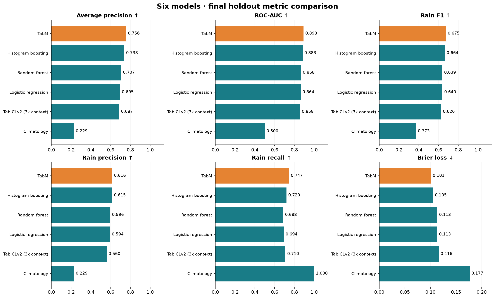
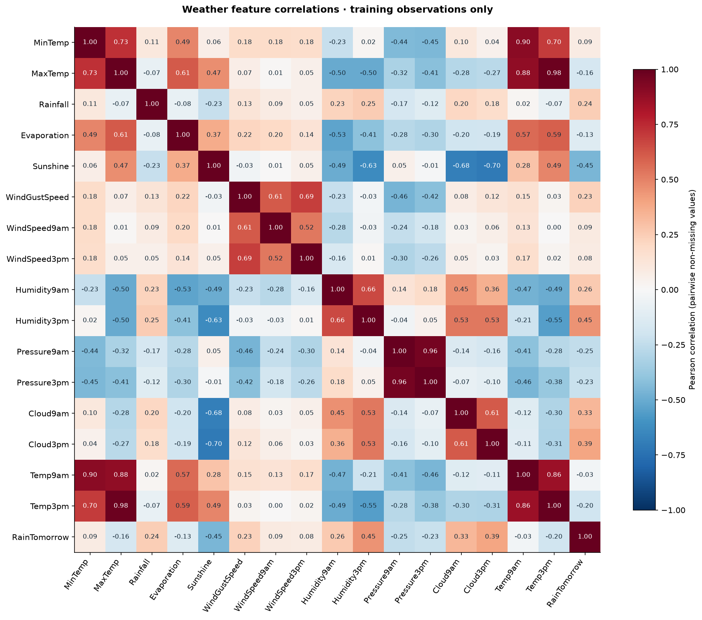
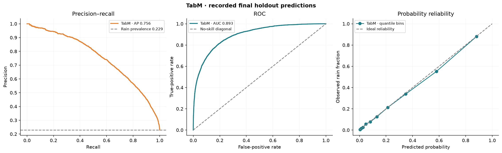
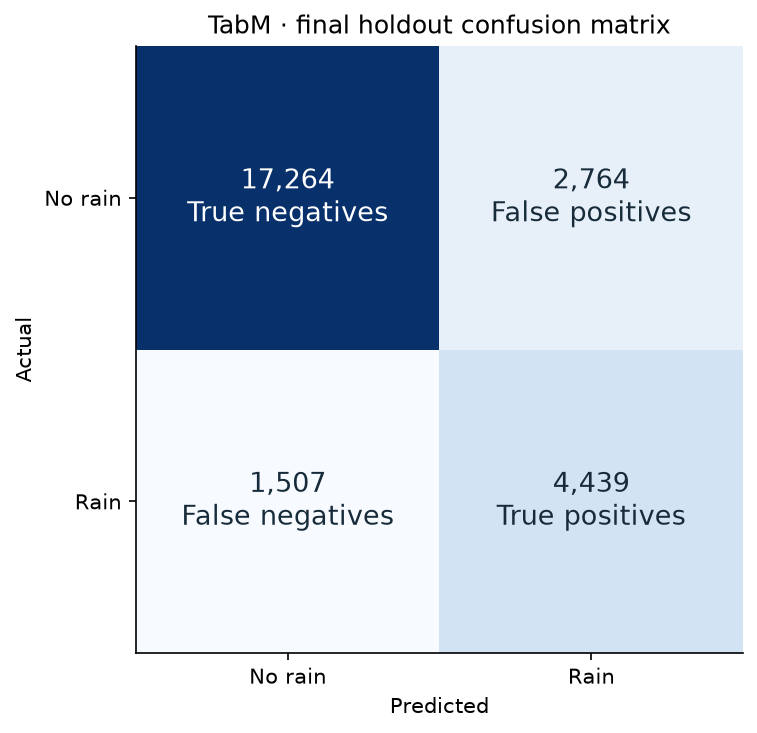
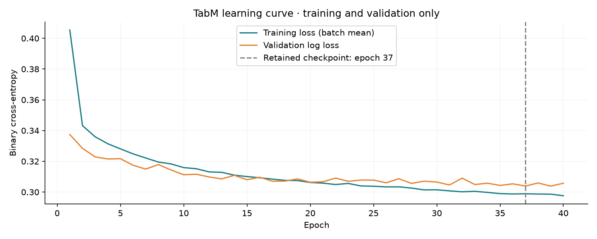
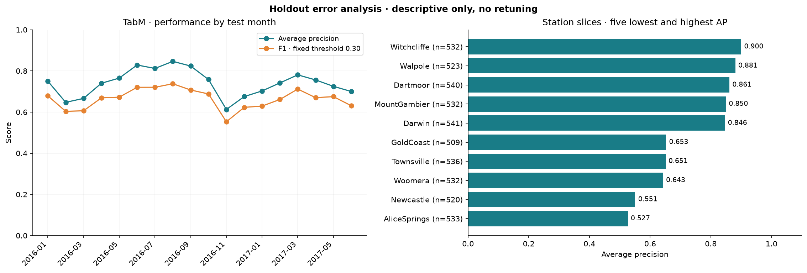
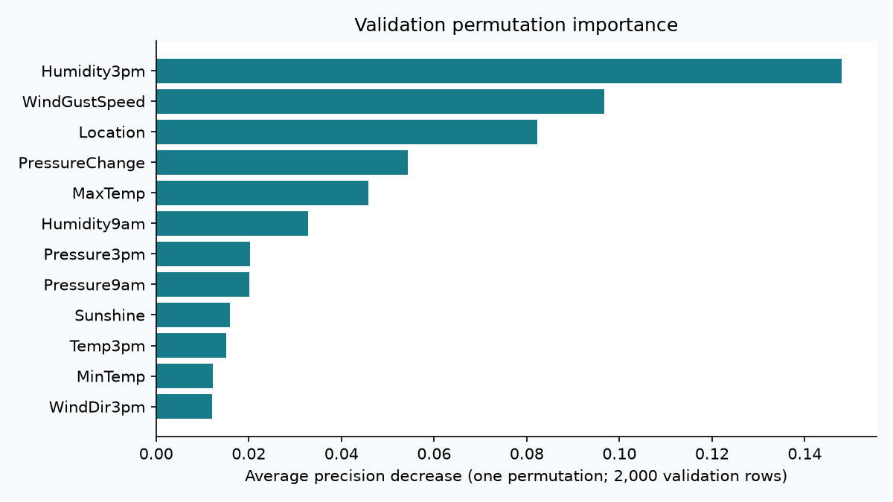
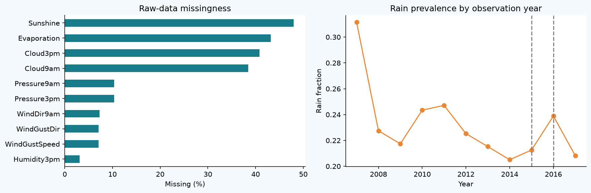

# RainScope ML — Australian Rainfall Prediction

Compare classical machine learning, **TabM** and **TabICLv2** for next-day rain classification from historical Australian weather observations.

**By Bola Maged Ramses Nessim** · [Setup & dashboard](docs/GETTING_STARTED.md) · [Detailed results](reports/RESULTS.md) · [Source attribution](docs/ATTRIBUTION.md)

## Model results

**TabM led this comparison:** accuracy **83.56%**, ROC-AUC **0.893**, average precision **0.756**, and rain-class F1 **0.675**.

| Model | Accuracy | Precision | Recall | F1 | ROC-AUC | Average precision |
| --- | ---: | ---: | ---: | ---: | ---: | ---: |
| **TabM** | 83.56% | 0.616 | 0.747 | 0.675 | 0.893 | 0.756 |
| Histogram gradient boosting | 83.29% | 0.615 | 0.720 | 0.664 | 0.883 | 0.738 |
| Random forest | 82.17% | 0.596 | 0.688 | 0.639 | 0.868 | 0.707 |
| Logistic regression | 82.12% | 0.594 | 0.694 | 0.640 | 0.864 | 0.695 |
| TabICLv2 (3k context) | 80.62% | 0.560 | 0.710 | 0.626 | 0.858 | 0.687 |
| Climatology baseline | 22.89% | 0.229 | 1.000 | 0.373 | 0.500 | 0.229 |

All results use **25,974 test observations from 2016–2017**. Model and threshold were selected on 2015 validation data before the test pass. TabICLv2 uses a 3,000-row training context; other models use 98,892 training rows. Precision, recall and F1 refer to **rain**. The climatology baseline's validation-selected threshold predicts every row as rain; its accuracy is not majority-class accuracy.

Higher is better for AP, ROC-AUC, F1, precision and recall; **lower is better for Brier loss**. Orange highlights TabM.

## Correlation heatmap

Pearson correlations for numeric weather features and the rain target, calculated on **training observations only** using pairwise non-missing values. Correlation does not establish causation.

## Precision–recall, ROC and probability reliability

The precision–recall curve shows rain detection versus false alarms; ROC shows ranking across thresholds. The reliability diagram compares predicted probabilities with observed rain frequencies.

## TabM confusion matrix

At the validation-selected threshold of **0.30**, TabM correctly identifies **4,439 rainy records** and **17,264 non-rainy records**; it misses **1,507 rainy records** and produces **2,764 false alarms**.

## Learning curve

Recorded training and validation losses across **40 epochs**. The dashed line marks the checkpoint retained by validation log loss; test data was not used for early stopping. Training loss is a batch mean measured with training-time dropout enabled.

## Performance across months and stations

Monthly AP/F1 uses the **same fixed 0.30 threshold** throughout the final test period. The station panel displays the five lowest and highest AP slices, with sample counts. Station scores also depend on local rain prevalence; these are descriptive diagnostics, not an unseen-station evaluation.

## Feature importance

Validation-only permutation importance measures the decrease in average precision when a feature is shuffled. **Humidity at 3pm, wind-gust speed, station location and pressure change** had the largest drops. Correlated features can share predictive information.

## Data quality and processing

**145,460 raw records · 49 stations · 3,267 missing targets excluded.** Sunshine is **48.0% missing** and evaporation **43.2% missing**. Numeric inputs use training-fitted median imputation with missingness indicators; categorical encoders are fitted only on training data.

A separate logistic-regression check on validation data found:

| Processing variant | Validation average precision |
| --- | ---: |
| Configured features and missingness indicators | 0.69885 |
| Without missingness indicators | 0.69525 |
| Without derived seasonal/pressure/humidity features | 0.69575 |
| Without numeric columns above 40% training missingness | 0.69683 |

These are modest, single-seed sensitivity results for logistic regression; they do not prove that every model benefits equally. [Recorded values](reports/preprocessing_sensitivity.csv)

## Measured runtime

Reference GPU: **NVIDIA GTX 1660 Ti, 6 GB**. These are measured in-process wall times, not deployment latency guarantees.

| Model | Fit time | Predict 25,974 rows |
| --- | ---: | ---: |
| **TabM** | 26.01 s | 0.099 s |
| Histogram gradient boosting | 5.73 s | 0.250 s |
| Random forest | 10.62 s | 0.221 s |
| Logistic regression | 2.23 s | 0.064 s |
| TabICLv2 (3k context) | 1.10 s | 139.442 s |
| Climatology baseline | 1.89 s | 0.194 s |

TabICLv2 performs in-context computation during prediction, so its short fit time does not mean cheap inference. [RAM, CPU and PyTorch-memory measurements](reports/resources.json) include interpreter/resident-model overhead; they are not isolated per-model memory requirements.

## Reproduce and explore

[Installation, training and dashboard](docs/GETTING_STARTED.md) · [Configuration](config.json) · [Experiment protocol](docs/EXPERIMENT_PROTOCOL.md) · [Model card](docs/MODEL_CARD.md)

This is a single-seed historical study with shared stations across time, not an operational weather service or an unseen-station benchmark. The rebuilt implementation preserves the [original repository's attribution](docs/ATTRIBUTION.md) and [GPL-3.0 licence](LICENSE); raw observations and model weights are not republished.
