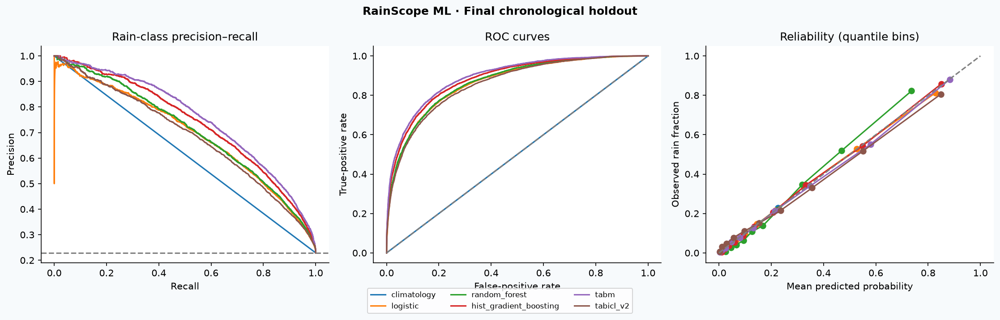

# Recorded experiment results

Selected on validation average precision: **tabm**. Decision threshold: **0.30**, chosen for validation F1. Test results below were not used to select the model or threshold. This is a bounded single-seed comparison, not an exhaustive model ranking.

## Data partitions

| split | rows | start | end | rain_rate |
| --- | --- | --- | --- | --- |
| train | 98892 | 2007-11-01 | 2014-12-29 | 0.2252 |
| validation | 17136 | 2015-01-01 | 2015-12-29 | 0.2126 |
| test | 25974 | 2016-01-01 | 2017-06-25 | 0.2289 |

Two-day embargoes separate observations across split boundaries. All learned preprocessing is fitted on training only. Same weather stations can appear across time; this does not measure generalization to unseen stations.

## Validation comparison

| model | training_rows | average_precision | roc_auc | f1 | threshold |
| --- | --- | --- | --- | --- | --- |
| tabm | 98892 | 0.7550 | 0.9028 | 0.6755 | 0.3000 |
| hist_gradient_boosting | 98892 | 0.7332 | 0.8927 | 0.6574 | 0.3000 |
| random_forest | 98892 | 0.7074 | 0.8802 | 0.6344 | 0.3000 |
| logistic | 98892 | 0.6988 | 0.8753 | 0.6386 | 0.3000 |
| tabicl_v2 | 3000 | 0.6954 | 0.8751 | 0.6330 | 0.3000 |
| climatology | 98892 | 0.2126 | 0.5000 | 0.3506 | 0.2000 |

## Final test comparison (diagnostic, not selection)

| model | selected_by_validation | average_precision | roc_auc | precision | recall | f1 | brier |
| --- | --- | --- | --- | --- | --- | --- | --- |
| climatology | False | 0.2289 | 0.5000 | 0.2289 | 1.0000 | 0.3726 | 0.1765 |
| logistic | False | 0.6953 | 0.8641 | 0.5938 | 0.6937 | 0.6399 | 0.1133 |
| random_forest | False | 0.7070 | 0.8675 | 0.5959 | 0.6879 | 0.6386 | 0.1134 |
| hist_gradient_boosting | False | 0.7383 | 0.8833 | 0.6153 | 0.7205 | 0.6637 | 0.1052 |
| tabm | True | 0.7564 | 0.8930 | 0.6163 | 0.7466 | 0.6752 | 0.1010 |
| tabicl_v2 | False | 0.6871 | 0.8577 | 0.5605 | 0.7101 | 0.6265 | 0.1163 |

Average precision is used directly, not trapezoidal PR-AUC. Positive-class metrics refer to rain. TabICLv2 receives a training-only stratified context capped at 3000 rows to fit a 6 GB GPU; other models use the complete training partition. Thus this is a resource-constrained comparison, not an equal-data benchmark. TabM early stopping monitors validation log loss.




## Uncertainty and resources

Selected model test AP: 0.7564; F1: 0.6752. Month-cluster bootstrap intervals: AP [0.7245378953088429, 0.7838493076408038]; F1 [0.6531093720970296, 0.6942019862151516]. These descriptive intervals do not establish robustness to unseen locations or future climate regimes.

[Resource measurements](resources.json) report fit/predict wall time, peak process RSS, mean process CPU percentage (may exceed 100% across cores) and peak PyTorch CUDA allocation. Process RSS includes the interpreter baseline and resident preceding models. These are not whole-system measurements. Foundation-model prediction performs most in-context computation. [Station slices](station_metrics.csv) expose geographic variation; do not optimize on test slices.

## Processing analysis

- Drop missing target labels; never impute the target.
- Preserve numeric missingness with train-fitted median imputation and missing indicators.
- Fit categorical encoders on training only; handle unknown categories at inference.
- Derive cyclical month and within-day pressure/humidity changes without future observations.
- Keep plausible extremes; avoid arbitrary full-dataset clipping or balancing the test set.
- Exclude raw Date from model inputs; split before fitting transforms.
- Reject conflicting station/date duplicates and malformed numeric/date input.

This experiment uses one engineered feature set. It does not isolate the causal benefit of individual features. Permutation importance is validation-only and descriptive. Daily measurements can accumulate through midnight: this is historical daily-record classification, not a validated morning weather service. Foundation-model exposure to this public dataset during pretraining cannot be ruled out. No improvement over the upstream random-split notebook is claimed because protocols differ.

## Failed candidates

```json
{}
```

## Validation-only preprocessing sensitivity

[Recorded logistic-regression ablations](preprocessing_sensitivity.csv) compare the configured features with removing missing indicators, derived features, or numeric columns with more than 40% training missingness. Configured validation AP was 0.69885; without missing indicators it was 0.69525; without derived features 0.69575; without high-missingness numeric features 0.69683. These modest differences are descriptive, single-seed and specific to logistic regression. They were not used to retune the selected model or revisit the test holdout. Run `python scripts/check_processing.py` separately to reproduce them.

Peak PyTorch memory in the resource file includes other models resident in the same process. Nonzero GPU allocation during a CPU estimator phase does not mean that estimator uses a GPU. CPU percentages for sub-100ms phases are especially coarse; cold-start and isolated-process benchmarks would be needed for deployment sizing.
