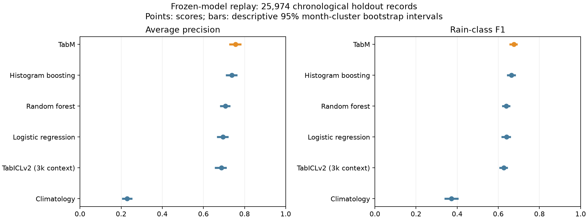

# Frozen-model verification — 22 October 2026

**All six saved models reproduced their recorded holdout metrics within absolute tolerance 1e-5.** No models were retrained or tuned. Dataset SHA-256 and saved selection matched the original experiment; validation-selected thresholds reproduced. This is a reproducibility check on an already evaluated holdout, not a new independent benchmark.

| Model | Accuracy | Precision | Recall | F1 | ROC-AUC | AP | Brier ↓ | Test prediction time |
| --- | ---: | ---: | ---: | ---: | ---: | ---: | ---: | ---: |
| TabM | 83.56% | 0.616 | 0.747 | 0.675 | 0.893 | 0.756 | 0.101 | 0.076 s |
| Histogram boosting | 83.29% | 0.615 | 0.720 | 0.664 | 0.883 | 0.738 | 0.105 | 0.231 s |
| Random forest | 82.17% | 0.596 | 0.688 | 0.639 | 0.868 | 0.707 | 0.113 | 0.215 s |
| Logistic regression | 82.12% | 0.594 | 0.694 | 0.640 | 0.864 | 0.695 | 0.113 | 0.050 s |
| TabICLv2 (3k context) | 80.62% | 0.560 | 0.710 | 0.626 | 0.858 | 0.687 | 0.116 | 138.236 s |
| Climatology | 22.89% | 0.229 | 1.000 | 0.373 | 0.500 | 0.229 | 0.177 | 0.047 s |



## Protocol and interpretation

- Training: 98,892 observations through 2014; validation: 17,136 observations in 2015; test: 25,974 observations from 2016–2017. Two-day split embargo retained. Station identities overlap across periods.
- Numeric imputation medians, scaler sample counts and categorical vocabularies match training-only data for all models. TabICLv2 matches its deterministic 3,000-row stratified training context.
- TabM remains the validation-selected model and has the highest AP and lowest Brier loss in this replay. The intervals do not establish statistically significant superiority.
- An always-no-rain classifier would reach 77.11% accuracy with zero rain recall. The climatology row instead uses its frozen F1-selected threshold, predicting rain throughout; do not compare accuracy alone.
- TabICLv2 trades a small training context for expensive prediction. Its short historical fit time is not its request latency.
- Resource readings are process-level, with all saved models loaded before scoring. RSS and allocated CUDA memory include resident models and interpreter overhead; they are not isolated model memory requirements. CPU percentages use one core as 100%. HTTP benchmarks are a separate workload.
- Bootstrap bars resample whole test months 200 times. They describe temporal variability for this particular historical split; this remains a single-seed experiment.

## Reproduce

Use the existing project environment with modern CUDA dependencies and trusted local artifacts:

```bash
OMP_NUM_THREADS=4 OPENBLAS_NUM_THREADS=4 python scripts/verify_models.py
python scripts/verify_preprocessing.py
python scripts/build_verification_report.py
```

[Full metrics, confusion matrices, resource readings and intervals](verification.json) · [Training-preprocessing audit](preprocessing_audit.json) · [CSV leaderboard](leaderboard.csv)

The source dataset and fitted artifacts remain local. These scripts verify trusted models created by this project; joblib files from untrusted sources must not be loaded.
